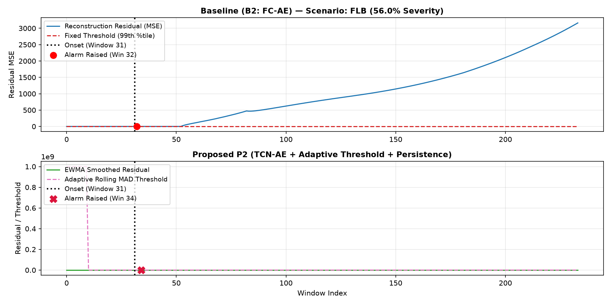
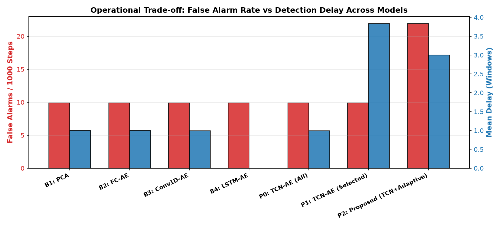
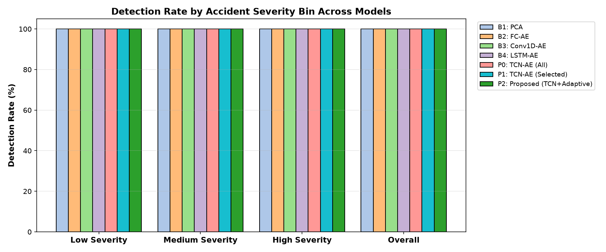
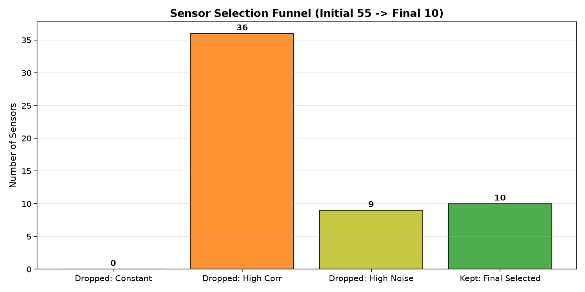

# Nuclear Power Plant Anomaly Detection (NPPAD) Benchmark

A comprehensive, reproducible deep learning proof-of-concept benchmark for time-series anomaly detection in nuclear power plants, evaluated on the open **NPPAD (Nuclear Power Plant Accident Data)** dataset simulated using PCTRAN.

---

## 1. Overview & Architecture

This repository evaluates four standard baseline architectures and three proposed causal temporal convolutional network (TCN) variants across 17 distinct nuclear accident types (e.g., LOCA, SGATR, FLB, MD, LR, ATWS, LOF, etc.) and varying accident severity levels (1% to 100%).

### Models Evaluated
- **B1: PCA** — Principal Component Analysis retaining 95% variance on flattened normal temporal windows.
- **B2: FC-AE** — Fully-Connected Autoencoder (`Linear -> ReLU -> Bottleneck -> Linear`).
- **B3: Conv1D-AE** — 1D-Convolutional Autoencoder with transposed convolutions.
- **B4: LSTM-AE** — Long Short-Term Memory Autoencoder (`LSTM Encoder -> RepeatVector -> LSTM Decoder -> Linear`).
- **P0: TCN-AE (All Sensors)** — Dilated Causal Temporal Convolutional Autoencoder with residual connections across all active sensors.
- **P1: TCN-AE (Selected Sensors)** — Dilated Causal TCN-AE trained strictly on informative sensors filtered by variance, collinearity, and AE reconstruction noise.
- **P2: Proposed Pipeline (Full)** — P1 combined with EWMA smoothing, streaming adaptive rolling Median Absolute Deviation (MAD) dynamic thresholds, and a 3-step persistence filter.

---

## 2. Dataset Assumptions & Exploration Decisions

1. **Active Sensors & Invariant Features**:
   - The raw plant records 96 operational process sensors (+ `TIME`).
   - 41 sensors remain strictly invariant across normal steady-state operation; these constant sensors are dropped to prevent degenerate zero-variance normalization.
   - All models are trained on the remaining 55 active sensors (or selected subset).

2. **Normal Baseline & Scenario Construction**:
   - PCTRAN accident simulations initialize at 100% full-power steady-state.
   - To reflect streaming industrial operational monitoring with sliding window $W=30$, a realistic 60-step (600s) normal lead-in baseline from steady-state `Normal/1.csv` is prepended to each scenario.
   - Normal windows (label = 0) are extracted strictly from pre-accident segments of training and validation sets. Models are trained unsupervised on normal data only.
   - Fault occurs at onset step = 60 (label switches to 1).

3. **Stratified Splitting**:
   - Data is split **by scenario** (never by temporal window), stratified across accident categories:
     - **Train**: 70% of scenarios
     - **Validation**: 15% of scenarios
     - **Test**: 15% of scenarios

4. **Severity Binning**:
   - Severity is encoded by the simulation parameter filename (e.g., `50.csv` = 50% physical break or variation).
   - Single-scenario severe accidents (ATWS, LOF, LACP, TT, SP) are classified as 100% severity.
   - Binned into tertiles:
     - **Low Severity**: $\le 33\%$
     - **Medium Severity**: $33\% < \text{severity} \le 66\%$
     - **High Severity**: $> 66\%$

---

## 3. Installation & Setup

1. Clone repository and install dependencies:
```bash
pip install -r requirements.txt
```

2. Hardware requirement:
- Runs efficiently on CPU. All seeds fixed to `42` for exact reproducibility.

---

## 4. How to Run

### Quick Test Mode (5 epochs, subset of scenarios)
```bash
python main.py --quick
```

### Full Benchmark Run
```bash
python main.py
```

### Interactive Demo Web App (Streamlit)
```bash
streamlit run demo_app.py
```

---

---

## 5. Benchmark Results

### Overall Model Comparison
| Model | Params | ROC-AUC | Detection Rate (%) | False Alarm Rate (/1k) | Mean Delay (steps) |
|:---|:---:|:---:|:---:|:---:|:---:|
| **B1: PCA** | 13,200 | 0.9998 | 100.00% | 9.90 | 1.00 |
| **B2: FC-AE** | 215,042 | 1.0000 | 100.00% | 9.90 | 1.00 |
| **B3: Conv1D-AE** | 29,623 | 1.0000 | 100.00% | 9.90 | 0.99 |
| **B4: LSTM-AE** | 21,655 | 0.9998 | 100.00% | 9.90 | 0.00 |
| **P0: TCN-AE (All)** | 18,399 | 1.0000 | 100.00% | 9.90 | 0.99 |
| **P1: TCN-AE (Selected)** | 14,754 | 0.9992 | 100.00% | 9.90 | 3.83 |
| **P2: Proposed (TCN+Adaptive)** | 14,754 | 0.9992 | 100.00% | 21.90 | 3.00 |

### Visual Comparisons

#### Residual Profiles & Alarm Triggering (Baseline vs Proposed P2)


#### Operational Trade-Off: False Alarm Rate vs. Detection Delay


#### Detection Rate by Accident Severity Bin


#### Sensor Selection Pruning Funnel


